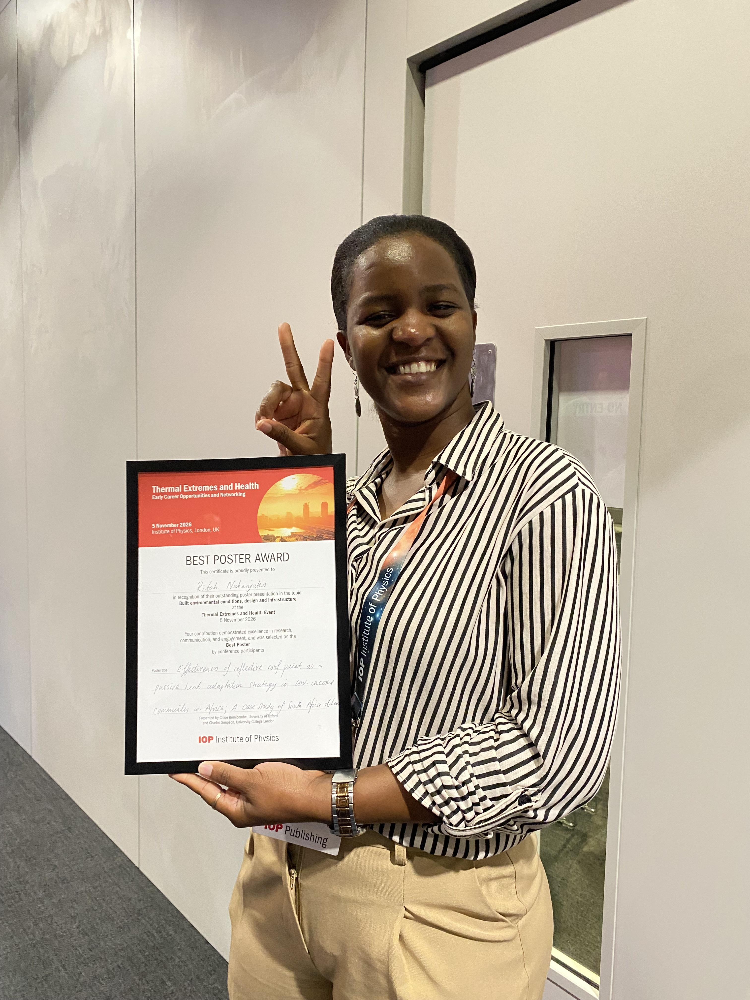

Ritah Pavin Nakanjako won Best Poster Award at the [Institute of Physics Publishing Thermal Extremes and Health event](https://iop.eventsair.com/eth2026/) in London!

Eunice Lo, Ruby Lieber, Dan Skinner and Alex Davies also attended this multidisciplinary event at the intersection of thermal extremes, physical health, and mental wellbeing. Eunice was on the careers progression panel for early career researchers.

